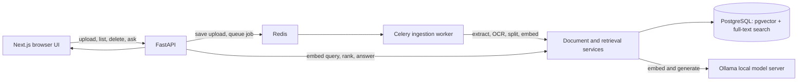

# PaperWise architecture

## Request flow

## Current design

- **Frontend:** Next.js App Router and TypeScript. The browser calls the FastAPI service directly.
- **API:** FastAPI validates uploads, extracts supported text, coordinates indexing and answers, and returns typed JSON.
- **Storage:** PostgreSQL holds document metadata, statuses, and passages. pgvector stores embeddings and PostgreSQL full-text search provides keyword ranking. Original uploads are retained in the local data volume for re-indexing.
- **Models:** Ollama creates embeddings and answers prompts. The base URL and model names are configurable.
- **Retrieval:** a custom state machine unions vector and full-text candidate sets, reranks them, checks a configurable semantic threshold, and passes only supported passages to answer generation. The answer's citation IDs must refer to retrieved passages or the workflow abstains.
- **Processing:** Redis queues uploads; a Celery worker extracts, optionally OCRs, chunks, embeds in batches, and records processing status and retry failures.
- **Session and library UX:** chat transcript persists in this browser's local storage; users can filter files and assign named collections.
- **Evaluation and traces:** a deterministic local evaluation script reports source hits, expected-phrase recall, and citation validity. OpenTelemetry tracing can export over OTLP when configured.

## Recommended stack mapping

| Layer | PaperWise choice | Status |
| --- | --- | --- |
| Frontend | Next.js App Router, React, TypeScript | In place |
| Backend | Python, FastAPI, Pydantic | In place |
| AI orchestration | Custom retrieval-to-answer state machine | In place |
| Language model | Ollama local chat and embedding models | In place; hosted providers stay optional |
| Document parsing | PyMuPDF, python-docx, Markdown/text readers, optional Tesseract OCR | In place; Docling remains an optional extension |
| Retrieval | PostgreSQL, pgvector cosine search, PostgreSQL full-text keyword ranking | In place |
| Background processing | Redis + Celery | In place |
| Observability | OpenTelemetry OTLP exporter | Optional and disabled unless configured |
| AI evaluation | Custom deterministic tests and local evaluation set | In place; Ragas/DeepEval remain optional |
| Deployment | Docker Compose for local services, GitHub Actions CI | In place |

The default configuration does not require a cloud account, hosted inference, a paid API key, or paid deployment. Optional hosted adapters should be documented separately from the local path.

## Trust boundaries and current limits

- Treat uploaded files as untrusted input. Enforce extension and size limits and never execute document content.
- A document may contain adversarial instructions. The answer prompt labels passages as untrusted reference material and tells the model to ignore instructions found inside them.
- Generated answers are not guaranteed to be correct. The UI exposes the supporting passages for human review.
- This initial implementation has no user accounts or multi-user isolation. Compose binds published service ports to localhost; do not expose the services publicly without adding authentication and network controls.
- Approval-controlled workflows are a planned addition. The current app only answers questions; it does not take external actions.

## Next design steps

Next add user feedback, expert-reviewed evaluation labels and citation-to-claim checks, audit events, and a review queue for any future action that could change data outside PaperWise. Langfuse can be an optional local observability profile. Docker Compose remains the free local deployment path. Hosted models may be optional adapters, never required for the default setup.
